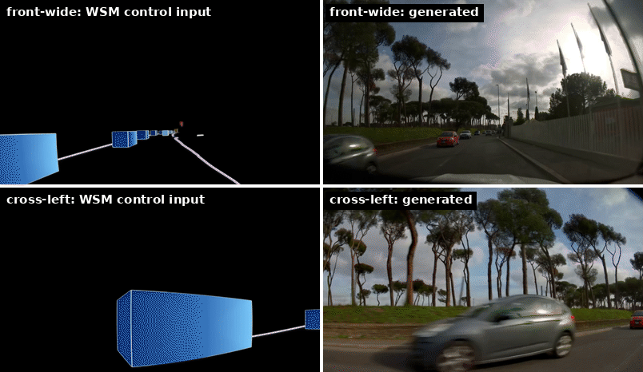
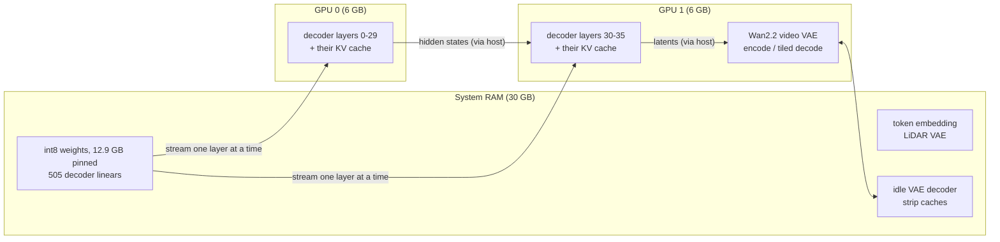
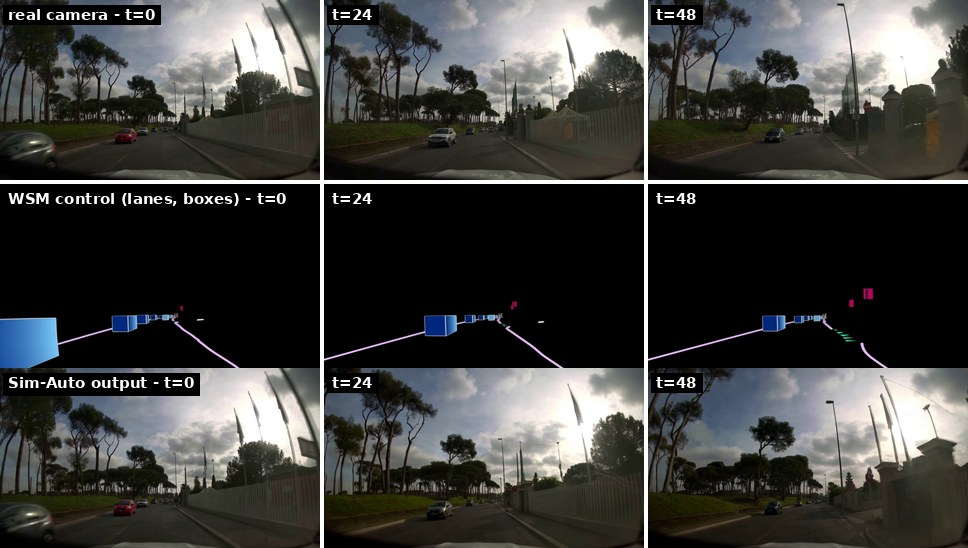
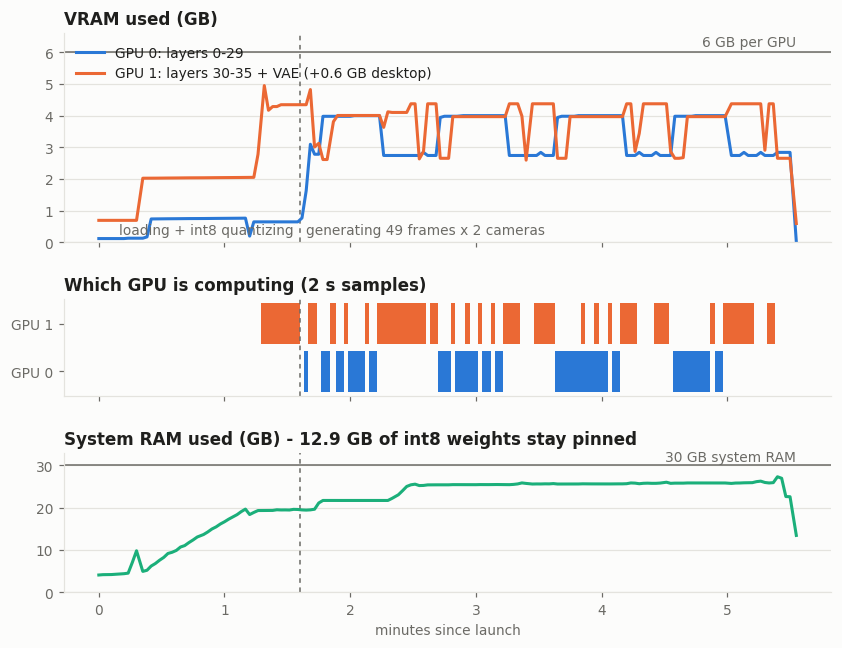
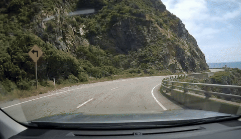
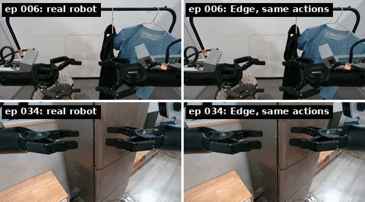
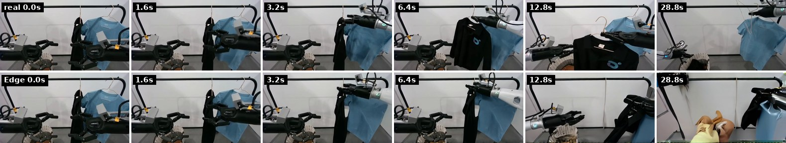
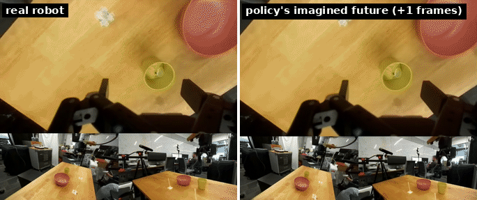
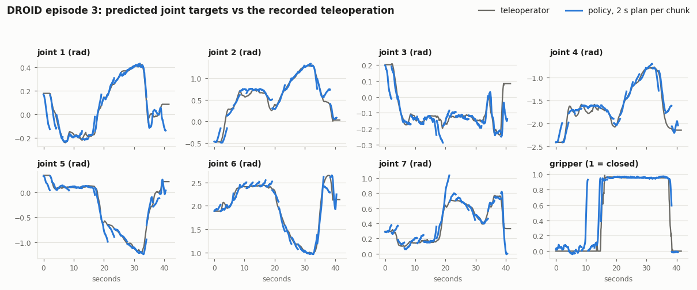
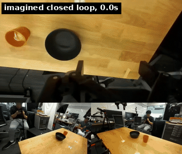

# Cosmos-Edge-Sim

Run NVIDIA Cosmos 3 world models on small Ampere GPUs. This was tested on a desktop with **2× RTX A2000 (6 GB each, sm_86) and 30 GB of RAM**.

| Model | What it does | Script | GPUs |
|---|---|---|---|
| [Cosmos3-Nano-Sim-Auto](https://huggingface.co/nvidia/Cosmos3-Nano-Sim-Auto) (16B) | Closed-loop driving simulator: camera video that follows WSM lane/cuboid controls, optional LiDAR | `lowvram/simauto/run_sim_auto.py` | 2 |
| [Cosmos3-Edge](https://huggingface.co/nvidia/Cosmos3-Edge) (4B) | General image/text-to-video | `lowvram/run_edge.py` | 1 |
| Cosmos3-Edge (4B), forward dynamics | Bimanual robot simulator: head-camera video that follows [Cosmos3-Nano-Sim-Bimanual](https://huggingface.co/nvidia/Cosmos3-Nano-Sim-Bimanual) action files | `lowvram/bimanual/run_edge_bimanual.py` | 1 |
| [Cosmos3-Edge-Policy-DROID](https://huggingface.co/nvidia/Cosmos3-Edge-Policy-DROID) (4B) | Robot policy: camera views + joint state → next 32 joint targets and the imagined future video; open-loop, closed-loop-in-imagination and RoboLab websocket server | `lowvram/policy/droid_sim.py` | 1 |

<p align="center">
  
  <br>
  <em>Cosmos3-Nano-Sim-Auto, generated on 2× RTX A2000 (6 GB). Left: the WSM control input (lanes and object boxes). Right: the generated camera video. Two cameras, 49 frames, 480p; the oncoming red car seen ahead in the front view later passes through the cross-left view.</em>
</p>

---

## Cosmos3-Nano-Sim-Auto on 2× 6 GB GPUs

NVIDIA's runtime ([cosmos-framework](https://github.com/NVIDIA/cosmos-framework)) assumes Hopper or Blackwell GPUs with ≥ 80 GB of memory. It puts all ~30 GB of bf16 weights on every GPU and needs FlashAttention-4. `lowvram/simauto/run_sim_auto.py` runs the unmodified framework with these patches:

| Patch | File |
|---|---|
| FlashAttention-4 "gapped replay" attention is replaced by PyTorch's memory-efficient attention kernel (sm_80+), which returns the log-sum-exp without materializing scores. It is tested against an exact fp32 reference. | `fa_shim.py` |
| 505 MoT decoder linears are int8 per-channel weights (12.9 GB) held in pinned CPU RAM and streamed layer by layer to the GPU that runs the layer, with the next layer prefetched. The token embedding stays on CPU and the unused text `lm_head` is dropped. | `int8_stream.py` |
| The decoder layers are split across the GPUs: layers 0–29 on GPU 0, layers 30–35 on GPU 1. Each layer's rolling KV cache lives on its own GPU. | `layer_split.py` |
| The Wan2.2 video VAE runs on GPU 1. It is loaded on CPU first, encodes 4-frame chunks, and decodes each camera separately in three overlapping width strips. Idle strip caches wait in host RAM. | `run_sim_auto.py`, `vae_tiling.py` |
| The LiDAR VAE stays on CPU unless `SIM_AUTO_LIDAR_GPU` is set (needed only for joint camera+LiDAR requests). | `run_sim_auto.py` |
| The launcher re-execs itself with `nop2p/libnop2p.so` preloaded, so CUDA never uses the broken direct GPU↔GPU copies. See "Hardware note" below. | `run_sim_auto.py`, `nop2p/` |

How the 16B model is spread over two 6 GB GPUs and system RAM:



### Result

| Request | Generation | Total | Peak VRAM GPU 0 / GPU 1 |
|---|---|---|---|
| 1 camera (`camera_front_wide_120fov`), 49 frames, 480p, RGB, first-frame conditioned | 3 min 10 s | 263 s | (before the layer split) |
| 2 cameras (`front_wide` + `cross_left`), 49 frames, 480p, RGB | 3 min 51 s | 315 s | 3.17 GiB / 4.15 GiB |

The output follows the daytime sample's real scene and its WSM controls: road layout, oncoming cars, roadside fence and gateposts. With two cameras the views stay consistent: an oncoming red car seen ahead in the front view later passes through the cross-left view.

<p align="center">
  
  <br>
  <em>Front camera at frames 0, 24 and 48. Top: the real recording from NVIDIA's daytime sample (only frame 0 is given to the model). Middle: the WSM control the model follows. Bottom: the generated video, which reproduces the scene layout, the oncoming traffic and the gateposts at frame 48 without seeing the real frames 1–48.</em>
</p>

Memory and GPU activity over the whole 2-camera run, sampled every 2 seconds:

<picture>
  <source media="(prefers-color-scheme: dark)" srcset="docs/media/memory_timeline_dark.png">
  
</picture>

- Both GPUs stay under their 6 GB limit; GPU 1 also carries about 0.6 GB for the desktop.
- The middle panel shows the GPUs taking turns: GPU 0 runs layers 0–29, then GPU 1 runs layers 30–35 and the VAE.
- System RAM is the tightest resource: the pinned int8 weights plus decoder caches peak at about 27 GB of 30 GB.

The two GPUs work in turn, not at the same time: the layers run in sequence, so GPU 0 computes layers 0–29, then GPU 1 computes layers 30–35 and decodes video.

### Setup

```bash
git clone https://github.com/NVIDIA/cosmos-framework third_party/cosmos-framework
cd third_party/cosmos-framework
curl -LsSf https://astral.sh/uv/0.11.29/install.sh | env UV_INSTALL_DIR="$HOME/.local/bin" sh
~/.local/bin/uv sync --locked --python 3.13 --group cu130-train --extra train --extra guardrail
cd ../..
hf download nvidia/Cosmos3-Nano-Sim-Auto --local-dir checkpoints/Cosmos3-Nano-Sim-Auto   # ~32 GB
```

The Wan2.2 VAE (`Wan-AI/Wan2.2-TI2V-5B`) downloads automatically on the first run.

### Usage

```bash
PY=third_party/cosmos-framework/.venv/bin/python
# Build a reduced request from NVIDIA's published daytime sample (fetched on first use)
$PY lowvram/simauto/prepare_request.py --views camera_front_wide_120fov --num-frames 49 \
    -o outputs/sim_auto/requests/front_49f.json
# Generate. Extra arguments go straight to cosmos_framework.scripts.inference
$PY lowvram/simauto/run_sim_auto.py -i outputs/sim_auto/requests/front_49f.json \
    -o outputs/sim_auto/front_49f --checkpoint-path checkpoints/Cosmos3-Nano-Sim-Auto
```

Videos are written to `outputs/sim_auto/front_49f/daytime_scene/vision_view00_*.mp4`.

The README figures are rebuilt from these outputs with `third_party/cosmos-framework/.venv/bin/python scripts/make_media.py` (it reads the 2-camera run in `outputs/sim_auto/2cam_49f/`, its memory trace `outputs/sim_auto/2cam_mem.log`, and `outputs/edge_121f.mp4`).

Environment knobs:

| Variable | Default | Meaning |
|---|---|---|
| `SIM_AUTO_VAE_GPU` | 1 | GPU for the video VAE and the split-off layers |
| `SIM_AUTO_SPLIT_LAYER` | 30 | First decoder layer that runs on the second GPU (36 layers; 0 disables the split) |
| `SIM_AUTO_LIDAR_GPU` | `cpu` | Device for the LiDAR VAE; set to 0 for joint camera+LiDAR requests |
| `SIM_AUTO_VAE_ENCODE_FRAMES` | 4 | Frames per VAE encode chunk |
| `SIM_AUTO_VAE_TILE_LATENT` | 22 | Latent columns per decode strip |
| `SIM_AUTO_VAE_TILE_OVERLAP` | 8 | Overlap between decode strips, in latent columns |
| `SIM_AUTO_VAE_CACHE_DEVICE` | `cpu` | Where idle decoder strip caches wait |
| `SIM_AUTO_ATTN` | — | `exact` switches the attention shim to the fp32 matmul path (more memory) |
| `SIM_AUTO_ALLOW_P2P` | — | Set to 1 to skip the no-P2P shim on machines where peer copies work |
| `SIM_AUTO_MEMSNAP` | — | Path: record CUDA allocations on GPU 0 and dump a snapshot if generation fails |
| `SIM_AUTO_DEBUG` | — | Set to 1 to print per-layer activation and VAE input/output statistics |

### Limits

- Tested with one and two cameras at 480p, RGB, 49 frames. Three or more cameras, longer rollouts and joint LiDAR are untested; the rolling KV cache grows with the number of views. Move `SIM_AUTO_SPLIT_LAYER` down to give GPU 1 more layers if GPU 0 runs out, or up if GPU 1 does.
- The int8 weights add some quantization error compared with NVIDIA's bf16 reference. The attention shim is slower than FA4.
- About 13 GB of RAM stays locked for the weights. Leave about 6 GB free beyond that.
- Run it outside Claude Code's background-task memory guard (for example `setsid nohup ... &`) or in your own terminal.

### Hardware note: GPU peer-to-peer copies are broken on this machine

CUDA reports peer access between the two A2000s, and `nvidia-smi topo -p2p r` shows "OK". But a direct `tensor.to("cuda:1")` from `cuda:0` silently returns **all zeros**; staging through host RAM works. This is the usual symptom of the IOMMU or PCIe ACS blocking P2P.

- `run_sim_auto.py` preloads `lowvram/simauto/nop2p/libnop2p.so` (built with `gcc` on first use). It makes `cudaDeviceCanAccessPeer` report 0, so PyTorch falls back to `cudaMemcpy`, which the driver stages through host memory. This covers every `.to(device)` inside the framework, not just our own code. It prints `cross-GPU copy check: ok` at startup.
- Use the same shim for any other multi-GPU job on this machine: `LD_PRELOAD=$PWD/lowvram/simauto/nop2p/libnop2p.so python ...`
- Disabling the IOMMU or ACS in the BIOS or kernel options would let direct copies work.
- The same bug is why splitting Cosmos3-Edge's layers across both GPUs with `accelerate` produced noise.

Quick check:

```bash
python -c "import torch;a=torch.ones(10,device='cuda:0');print(a.to('cuda:1'))"   # zeros = broken P2P
```

---

## Cosmos3-Edge on one 6 GB GPU

The official recipe (`pipe.to("cuda")`) needs about 10 GB of VRAM for the bf16 weights alone. `lowvram/run_edge.py` brings the peak down to **about 3 GB**:

| Technique | What it saves |
|---|---|
| Diffusers group offloading: transformer weights stay in pinned CPU RAM, 2 decoder layers at a time are streamed to the GPU on a side CUDA stream | ~6.7 GB of transformer weights |
| VAE (Wan2.2) kept on CPU; moved to the GPU only for the conditioning encode and the final tiled decode | ~1.4 GB during denoising |
| Image-to-video encodes only the conditioning frame (the stock pipeline VAE-encodes the image repeated over all frames, but keeps only latent frame 0) | ~2.5 GB peak at 480p |
| `cosmos_guardrail` safety checker off by default (`--safety` turns it on) | several GB |

| Frames | Resolution | Steps | Denoise | VAE decode | Total | Peak VRAM |
|---|---|---|---|---|---|---|
| 33 | 832×480 | 20 | 92 s | 26 s | 132 s | 2.2 GB |
| 121 (model-card default) | 832×480 | 20 | 217 s | 94 s | 321 s | 3.0 GB |

<p align="center">
  
  <br>
  <em>Cosmos3-Edge image-to-video on one 6 GB GPU: the model card's example image and prompt (a dashcam drive on a coastal mountain road), 121 frames at 832×480, shown at every 3rd frame.</em>
</p>

```bash
scripts/setup_env.sh            # conda env "cosmosim": Python 3.12, torch 2.11 cu128, diffusers 0.41.0
conda activate cosmosim
scripts/download_edge.sh        # ~8.6 GB into checkpoints/Cosmos3-Edge
PYTORCH_CUDA_ALLOC_CONF=expandable_segments:True python lowvram/run_edge.py --gpu 0
python lowvram/run_edge.py --gpu 1 --image my_frame.jpg --prompt "Dashcam view, light rain, ..." \
    --num-frames 61 -o outputs/my_run.mp4
```

Flags:
- `--offload-blocks N`: layers streamed per group. Higher is faster but uses more VRAM.
- `--num-frames`, `--steps`, `--guidance`, `--flow-shift`, `--seed`.

With two GPUs, run two Edge jobs in parallel, one with `--gpu 0` and one with `--gpu 1`.

---

## Bimanual robot simulation with Cosmos3-Edge

[Cosmos3-Nano-Sim-Bimanual](https://huggingface.co/nvidia/Cosmos3-Nano-Sim-Bimanual) is a 16B model post-trained to simulate AgiBot bimanual robots: given the head-camera image and a sequence of arm/gripper actions, it renders what the robot would see. It targets Hopper/Blackwell GPUs. This is a lightweight substitute: the Cosmos3-Edge base model already has a `forward_dynamics` action mode with an `agibotworld` embodiment, so `lowvram/bimanual/` drives that with Sim-Bimanual's own action files on **one 6 GB GPU (3.0 GB peak)**.

<p align="center">
  
  <br>
  <em>Left: the real robot. Right: Cosmos3-Edge given only the first frame and the recorded actions. First 6.4 s of episodes 006 (hanging a shirt) and 034 (opening a fridge).</em>
</p>

How it works:

1. **`convert_actions.py`** translates Sim-Bimanual's 59-D `normalized_unified_v1` actions into the base model's 29-D `agibotworld` actions (head, both wrists, both grippers). It uses cosmos-framework's own pose and normalization code:
   - undoes the `global_asinh` normalization;
   - rebuilds absolute head and wrist trajectories from the 16-frame chunk-anchored deltas;
   - resamples from 30 to 10 fps;
   - re-encodes as framewise rot6d deltas, gripper width as an open fraction, with `quantile` normalization.

   Re-encoding the rebuilt trajectories reproduces the original actions to within 2×10⁻⁷. 1–2% of the converted values fall outside the base model's training range and are clipped.
2. **`run_edge_bimanual.py`** rolls the scene forward 16 actions (1.6 s) at a time. Each chunk is conditioned on the last generated frame of the previous one. The transformer is streamed from pinned RAM as in `run_edge.py`; the VAE stays on the GPU because a chunk is only 17 frames.

```bash
hf download nvidia/Cosmos3-Nano-Sim-Bimanual --local-dir checkpoints/Cosmos3-Nano-Sim-Bimanual-assets \
    --include "assets/training/agibot/*"            # example episodes: actions, first frames, real videos
A=checkpoints/Cosmos3-Nano-Sim-Bimanual-assets/assets/training/agibot
COSMOS_TRAINING=0 third_party/cosmos-framework/.venv/bin/python lowvram/bimanual/convert_actions.py \
    $A/actions/agibot_006_normalized_unifiedv1.json -o outputs/bimanual/agibot_006_edge29d.json
conda activate cosmosim
python lowvram/bimanual/run_edge_bimanual.py --gpu 0 --image $A/images/agibot_006_initial.png \
    --actions outputs/bimanual/agibot_006_edge29d.json -o outputs/bimanual/agibot_006_edge.mp4
```

Flags: `--chunks N` (default: all), `--task "..."` (short action description for the caption), `--steps`, `--flow-shift`, `--seed`, `--gpu`.

### Result

All three example episodes (29 s each, 18 chunks, 289 frames at 640×352): about 60 s per chunk, **18 min per episode, 3.0 GB peak VRAM**.

PSNR of the rollout against the real video, averaged per chunk:

| Episode | 0–1.6 s | 1.6–3.2 s | 3.2–4.8 s | 4.8–6.4 s | 8–29 s |
|---|---|---|---|---|---|
| 006 (shirt on hanger) | 31.2 dB | 20.0 | 17.4 | 15.8 | 11–13 |
| 001 (tabletop pick) | 33.8 dB | 24.7 | 23.7 | 16.9 | 12–16 |
| 034 (fridge) | 29.7 dB | 18.9 | 16.0 | 15.1 | 10–12 |

The arms move the way the actions say for the first few seconds. After that, errors compound. The arms leave the view or the scene drifts, and the model invents objects that were never there:

<p align="center">
  
</p>

### Limits

- **Use short horizons.** Rollouts are faithful for about 3–6 s. Sim-Bimanual carries a KV-cached history of all generated frames, but Edge's action pipeline takes a single conditioning frame (`CosmosActionCondition` uses only the first frame of `video`), so nothing anchors later chunks to the scene.
- Edge is the general 4B base model, not the bimanual post-train. Actions run at 10 fps (the base model's AgiBot rate) instead of 30, and Sim-Bimanual's fingertip slots have no `agibotworld` equivalent and are dropped.
- Only AgiBot episodes convert (rows routed to `agibotworld`, `agibot_gear_gripper*` or `camera_pose`). Other Sim-Bimanual embodiments are rejected.

---

## Robot action policy: Cosmos3-Edge-Policy-DROID

[Cosmos3-Edge-Policy-DROID](https://huggingface.co/nvidia/Cosmos3-Edge-Policy-DROID) is Cosmos3-Edge post-trained into a "world action model" policy for the DROID Franka arm ([training recipe](https://github.com/NVIDIA/cosmos-framework/blob/main/docs/action_policy_droid_posttrain.md)). From a language instruction, the wrist and two exterior cameras, and the current joint state, it generates the next **32 joint-position targets (2.1 s at 15 fps) together with a video of what it expects to happen**. `lowvram/policy/` runs it on **one 6 GB GPU (4.3 GB peak)**:

- `edge_policy.py` wraps cosmos-framework's own policy service (`action_policy_server_robolab`), so request building, state/action transforms and sampling (4 UniPC steps, guidance 3 in the timestep interval [960, 1001]) are NVIDIA's code. Only the model setup changes: the decoder layers' bf16 weights (5.2 GB) stay in pinned RAM and stream to the GPU (`lowvram/simauto/int8_stream.py`, now with `LOWVRAM_STREAM_DTYPE=bf16` for exact weights). The framework's own `enable_layerwise_offload` refuses this checkpoint because Edge uses generation-specific text-K normalization.
- `droid_sim.py` drives it with real DROID episodes from [nvidia/Cosmos3-DROID](https://huggingface.co/datasets/nvidia/Cosmos3-DROID), in three modes:
  - `eval`: open loop. At every 32-frame step of a recorded episode, the policy sees the real cameras and joint state; its plan is compared with what the teleoperator did next.
  - `dream`: closed loop in imagination. The policy's own predicted video frame and final joint targets become its next observation, so the model is its own simulator.
  - `serve`: the RoboLab/openpi websocket server from [action_policy_droid_server.md](https://github.com/NVIDIA/cosmos-framework/blob/main/docs/action_policy_droid_server.md), so a RoboLab client on another machine can control this GPU.

<p align="center">
  
  <br>
  <em>Open loop, episode 3 ("pour the contents from the cup into the bowl"). Left: the real cameras (wrist on top, two exterior views below). Right: the video the policy imagined from the frame at the start of each 32-step chunk while planning its actions.</em>
</p>

<picture>
  <source media="(prefers-color-scheme: dark)" srcset="docs/media/policy_joints_dark.png">
  
</picture>

```bash
A=checkpoints/droid_plus_lerobot_640x360_20260412     # the loader needs this directory name
hf download nvidia/Cosmos3-Edge-Policy-DROID --local-dir checkpoints/Cosmos3-Edge-Policy-DROID --exclude "images/*"
hf download nvidia/Cosmos3-DROID --repo-type dataset --local-dir $A \
    --include "success/meta/*.json" "success/meta/tasks.parquet" "success/meta/episodes/chunk-000/file-000.parquet" \
              "success/data/chunk-000/file-000.parquet" "success/videos/*/chunk-000/file-000.mp4"   # ~0.8 GB, 26 episodes
PY=third_party/cosmos-framework/.venv/bin/python
CUDA_VISIBLE_DEVICES=0 $PY lowvram/policy/droid_sim.py eval  --episode 3 --chunks 0    # whole episode
CUDA_VISIBLE_DEVICES=0 $PY lowvram/policy/droid_sim.py dream --episode 22 --chunks 10
uv pip install -p $PY openpi-server                                                    # once, for serve
CUDA_VISIBLE_DEVICES=0 $PY lowvram/policy/droid_sim.py serve --port 8000
```

### Result

| | Episode 3 (yellow cup → bowl) | Episode 22 (orange cup → black bowl) |
|---|---|---|
| Chunks (2.1 s each) | 19 | 13 |
| Joint error of the policy's plan vs the teleoperator | **0.061 rad** (3.5°) | **0.102 rad** (5.8°) |
| Baseline: hold the current pose | 0.103 rad | 0.172 rad |
| Chunks where the plan beats holding still | 13 / 19 | 11 / 13 |
| Gripper error (0–1) | 0.063 | 0.037 |

- Time per chunk on one RTX A2000: about **5 s for actions only** (`serve`, as RoboLab uses it) and **21 s with the imagined video decoded** (`eval`, `dream`). Load time 13 s, peak VRAM 4.26 GiB.
- The plans follow the operator closely once the arm is moving. They differ most when the human paused: at the start of episode 3 the operator waits 2 s and the policy starts reaching at once, and at about 10 s it closes the gripper a few seconds before the operator did.
- These episodes come from the dataset the policy was trained on, so this checks that the low-VRAM port reproduces the model. It is not a generalization benchmark.

Closed loop in imagination (episode 22, first 10 s). With nothing but its own predictions fed back, the policy reaches the orange cup and grasps it:

<p align="center">
  
</p>

After about 10 s (5 chunks) the imagined scene degrades: the exterior views break up and the pour never appears. Each chunk sees only the previous chunk's last imagined frame, so errors compound, as in the bimanual simulation above.

### What the referenced docs need that this machine can't run

- **Post-training** ([DROID](https://github.com/NVIDIA/cosmos-framework/blob/main/docs/action_policy_droid_posttrain.md), [LIBERO](https://github.com/NVIDIA/cosmos-framework/blob/main/docs/action_policy_libero_posttrain.md)): full fine-tuning with HSDP on 8–16 large GPUs and global batches of 2048–8192. Not feasible on 2× 6 GB.
- **LIBERO closed-loop eval**: needs a LIBERO-trained checkpoint, and NVIDIA has released none. The MuJoCo simulator itself would run here.
- **RoboLab** ([server doc](https://github.com/NVIDIA/cosmos-framework/blob/main/docs/action_policy_droid_server.md)): the client is Isaac Lab in Docker, beyond a 6 GB GPU that also hosts the policy. `droid_sim.py serve` speaks its protocol, so a RoboLab client elsewhere can use this GPU.

